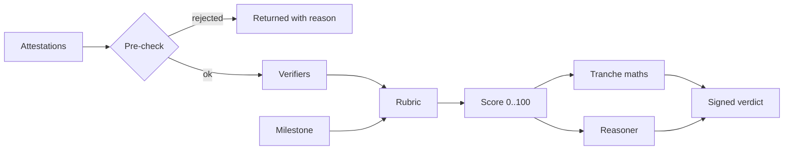

# The arbiter (proof-v1)

## Pipeline



## Rubric per proof type

| Proof type | Checks (weight) |
| --- | --- |
| `deploy` | deploy-live (20), tests-pass (20), chain-of-custody (20, optional), performance (20, optional without target), deadline (20) |
| `ci` | tests-pass (50), chain-of-custody (30), deadline (20) |
| `revenue` | revenue-target (80), deadline (20) |
| `ledger` | profitable (100) |
| `probe` | performance (80), deadline (20) |
| `commits` | chain-of-custody (80), deadline (20) |
| `manual` | manual (80), deadline (20) |

Scores from verifiers are 0..1. Missing evidence scores 0, or 1 when the check is optional.

```text
score = round(100 * sum(weight_i * s_i) / sum(weight_i))
pass     score >= passThreshold (80)
partial  partialFloor (50) <= score < passThreshold, if allowed
fail     otherwise
```

## Verifier details

**deploy.** Three fetches. Each non-2xx costs 5 points. Body hash mismatch halves the score. All three failing scores zero.

**ci.** Zero if the provider disagrees with the claimed numbers or the run is missing. Otherwise the pass ratio, with zero below the milestone's `passRatio` (default 0.9).

**probe.** Full marks at or under target, linear to zero at twice the target. Uptime under 99% halves it.

**revenue.** Average of `payingCustomers / target` and `mrr / target`, each capped at 1. With no target, any revenue passes.

**ledger.** Trailing streak of profitable months divided by the required streak, capped at 1.

## Reasoner

`TemplateReasoner` prints the scorecard. `AnthropicReasoner` asks Claude to explain the same scorecard in plain language, with a system prompt that forbids changing numbers or inventing evidence. The model's output is appended above the template, never used for scoring.

## Signature

```text
message   = `${buildId}:${milestoneId}:${score}:${reasoningHash}`
signature = ed25519(arbiterKey, message)
```

The program checks the same message with the Ed25519 program before `settle` runs.
