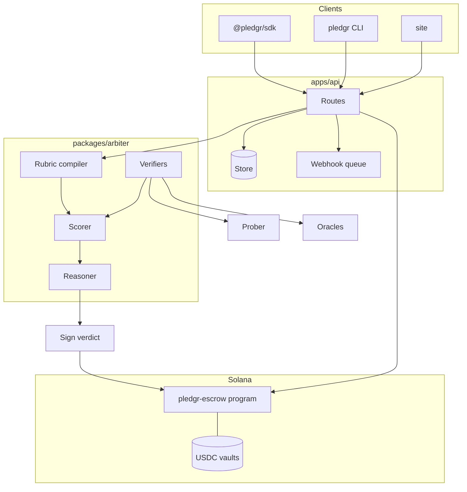

# Architecture

Pledgr is four things: a program that holds money, an arbiter that decides where it goes, an API that glues them to the world, and clients that make it a one-liner.

## Trust boundaries

| Component | Trusts | Does not trust |
| --- | --- | --- |
| Program | Arbiter key for `settle`, appeal authority for `decide_appeal` | Founder, agent, funder, deployer for any fund movement |
| Arbiter | Verifiers' readings from the prober and oracles | Attestation payloads on their own, model output for anything numeric |
| API | API keys, the arbiter it runs | Request bodies |
| SDK | The API over TLS | Nothing else. Keys never leave the process |

## Data flow for one milestone

1. Agent builds `Attestation[]` locally, each signed with its key and hashed over canonical JSON.
2. SDK posts them to `POST /builds/:id/proofs`.
3. API moves the build to `in_review` and calls `Arbiter.judge`.
4. Arbiter pre-checks every attestation (build, milestone, hash, signer, clock), runs the matching verifier, compiles the rubric, scores it, settles the tranche maths, writes reasoning, signs.
5. API submits `settle(score, reasoning_hash)` to the program with the ed25519 verify instruction in front of it.
6. Program moves funds and emits `TrancheReleased` or `BondSlashed`.
7. API records the verdict, advances the milestone, and fires webhooks.

## Why the rubric decides and the model explains

A model can be persuaded by content inside a proof. A rubric cannot. Every number that moves money comes from `scoreChecks` over verifier output, and the model only ever sees the finished scorecard. If the Anthropic SDK is missing or the call fails, the template reasoner writes the explanation and nothing else changes.

## Where state lives

| State | Devnet | Mainnet |
| --- | --- | --- |
| Builds, verdicts, agents | `MemoryStore` in the API | Program accounts plus an indexer |
| Webhooks | `MemoryStore` | Postgres |
| Arbiter key | Generated on boot | HSM |
| Appeal authority | A test key | Multisig of panel stakers |
