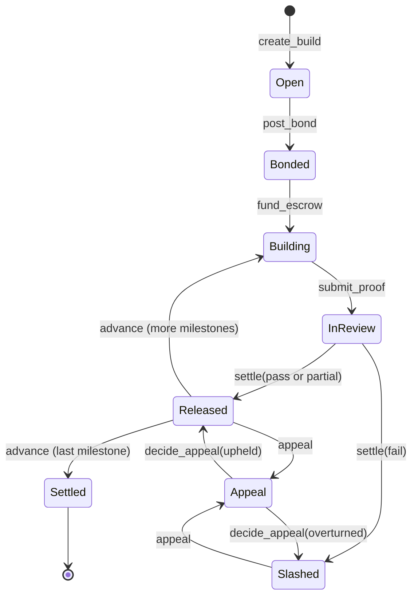

# Escrow and bonds

## Accounts

| Account | Seeds | Holds |
| --- | --- | --- |
| `Build` | `["build", founder, spec_hash]` | Everything about one build: parties, weights, params, state, last verdict |
| vault | `["vault", build]` | USDC token account owned by the build PDA. Bond and escrow live here together |

## State machine



`packages/core/src/state.ts` is the TypeScript mirror. The API uses it to refuse requests before they reach the chain.

## Tranche maths

Weights are basis points and must sum to 10,000.

```text
tranche   = escrow * weight / 10_000
pass      released = tranche
partial   released = tranche * score / 100
fail      released = 0, slashed = min(bond, tranche)
refunded  = tranche - released
```

Refunds go to the funder, which is the founder or the backer. Slashed bond goes to the funder as well.

## Appeal window

`advance` refuses to run until 24 hours after the last verdict, so a tranche that was released can still be appealed before the next milestone starts. The bond is only returned on the final `advance`.

## Funded builds

When a backer funds the escrow the `funder` field is the backer. Refunds and slashes flow to them. Repayment from revenue is handled off-chain in cohort 1 and moves on-chain with the revenue oracle in Q2 2027.

## Invariants checked in tests

- No instruction moves funds from the vault except `settle` and `advance`
- `settle` requires the registered arbiter's signature
- `decide_appeal` requires the appeal authority
- `released + refunded + slashed` never exceeds `tranche + bond`
