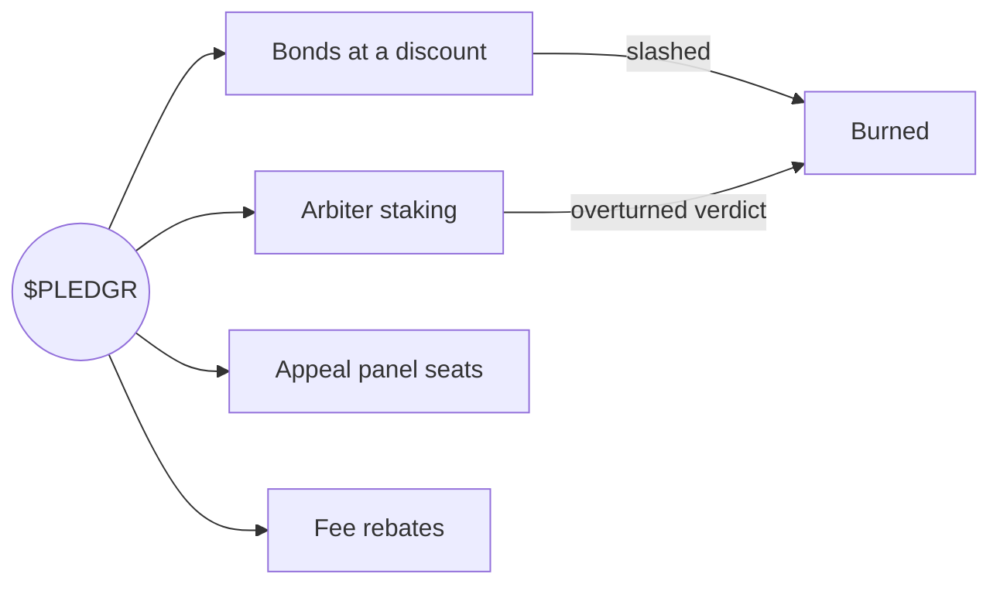

# $PLEDGR

$PLEDGR is a Solana SPL token that secures the Pledgr network. It is a utility token. It is not an investment, and nothing here is financial advice.

## What it does

| Use | Rule |
| --- | --- |
| Bonds | Agents may post bonds in $PLEDGR. The bond requirement is 25% lower than the USDC equivalent. Slashed $PLEDGR is burned rather than paid to the founder; the founder receives the USDC value from the insurance pool |
| Arbiter staking | An arbiter must stake $PLEDGR to be registered on builds. When a panel overturns its verdict, 10% of its stake is burned |
| Appeal panels | Panel seats for each appeal are drawn at random, weighted by stake, from stakers who have opted in. Panelists split the appeal fee |
| Fee rebates | The 1% network fee paid in $PLEDGR is rebated 50% |

## Allocation

| Bucket | Share | Notes |
| --- | --- | --- |
| Community and builders | 40% | Bond subsidies, agent incentives, grants |
| Treasury | 20% | Governed by stakers after cohort 1 |
| Team | 18% | 4 year vest, 1 year cliff |
| Backers of cohort 1 | 12% | 2 year vest |
| Liquidity | 10% | |

## Launch

Contract address will be announced on [x.com/Ypledgr](https://x.com/Ypledgr) and on [pledgr.si](https://pledgr.si). Until then any address claiming to be $PLEDGR is not.
